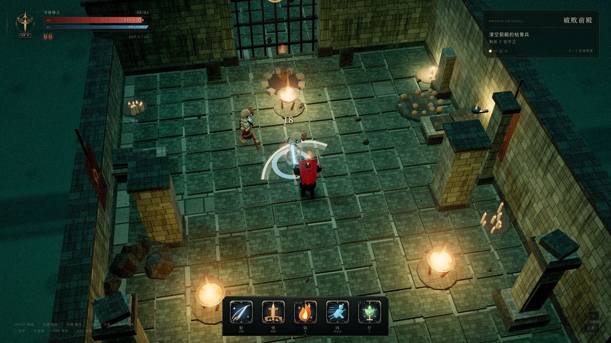

# 暗黑遗迹：灰烬王座 / ASHEN RELICS

**公开游玩：https://whs-blip.github.io/ashen-relics/**

一个可直接在浏览器运行的等距视角 3D 动作 RPG 垂直切片：三层遗迹、五技能战斗、Boss 两阶段、死亡重试与篝火存档。

## 操作

- `WASD` / 方向键：移动
- 鼠标左键：轻击（可连段）
- 鼠标右键：重击
- `Q`：火焰弹
- `Space`：闪避
- `1`：治疗瓶
- `E`：互动 / 拾取
- `Tab`：背包
- `Esc`：暂停
- 触屏：左下摇杆，右下技能键

## 技术

- Vite 8 + React 19 + TypeScript
- @react-three/fiber 9 + three.js 0.187
- 固定步长 1/60 战斗仿真；表现层独立
- 程序化石材 / 角色 / 敌人 / Boss / 技能 VFX
- Ashen Throne UI Kit 静态资产接入

本仓库是经过验证的生产构建（`dist`）。源码、完整 UI Kit 参考与分阶段质量报告作为离线交付包另行提供。

## 已知限制

- 程序化骨架，不是骨骼动画资产。
- 无头环境首次 Boss 特效存在冷启动长帧。
- UI Kit 的设置页、独立任务日志、独立加载页尚未实现。

## 许可

游戏代码使用 MIT License（见 `LICENSE`）。UI Kit 图片/图标由项目方提供，保留其各自权利。
